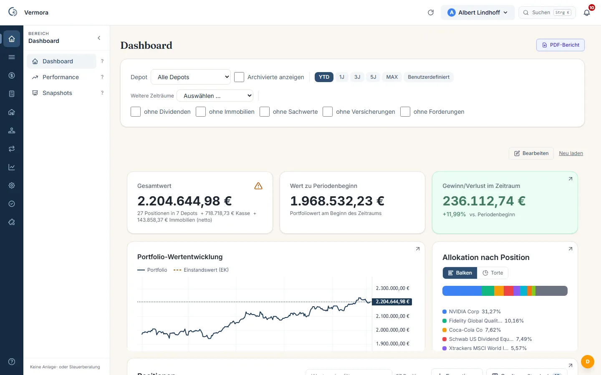
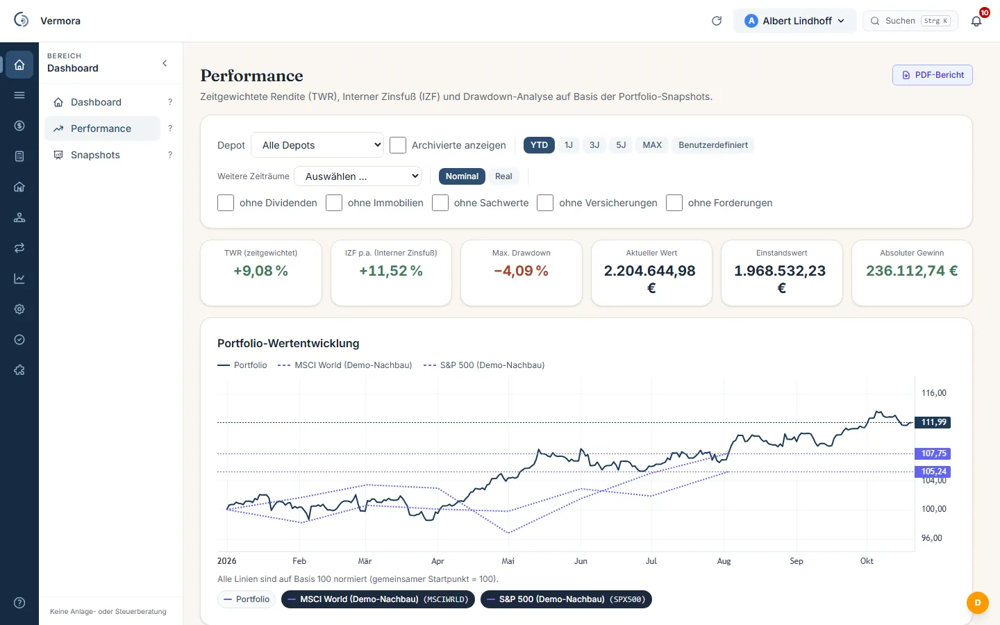
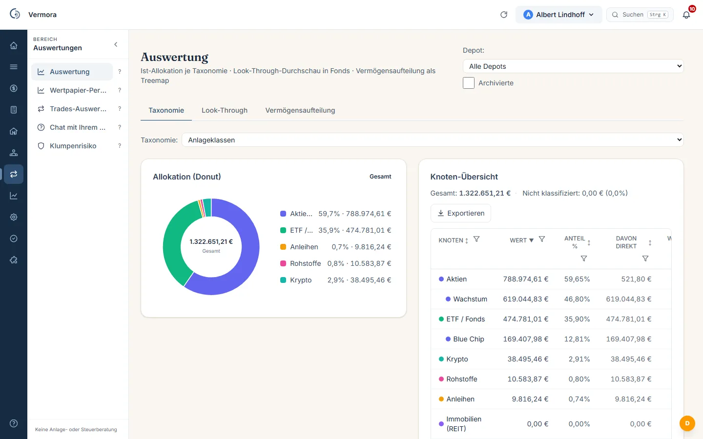
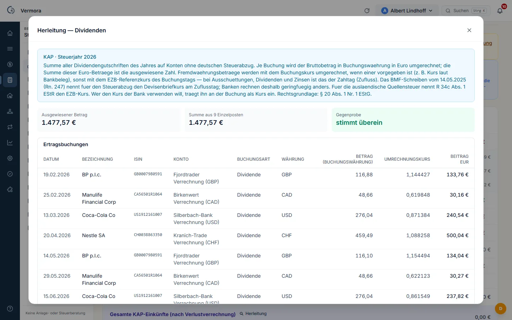

# Vermora

**Ein Vermögen. Ein Wahrheitsort.**

Vermora ist eine Anwendung für den eigenen Haushalt: Depots, Konten, Immobilien, Darlehen,
Optionen und Krypto an einer Stelle, mit Verlauf über Jahre und mit einer Herleitung zu jeder
Zahl. Sie läuft auf Ihrer eigenen Hardware: auf dem Rechner, auf einem NAS oder auf einem
gemieteten Server. Vermora ist und bleibt kostenlos.

Dieses Repository enthält nur die veröffentlichten Fassungen und das signierte
Release-Manifest, keinen Programmcode.

## Warum es das gibt

Angefangen hat es bei mir mit Tabellenkalkulation. Ich wollte wissen, was da ist und wie es
sich entwickelt, und habe mir die Übersicht selbst gebaut: Auswertungen in Tabellen, daneben ein
Haushaltsbuch, später die Fortschreibung von Darlehen mit Zins und Tilgung. Jede Tabelle war für
sich übersichtlich. Zusammen ergaben sie kein Bild.

Dann kam ein Depot in Fremdwährung bei einer Bank ohne deutschen Steuerabzug dazu. Jeden Kauf,
jeden Verkauf und jede Dividende habe ich selbst aufbereitet, zum Umrechnungskurs des jeweiligen
Tages, Jahr für Jahr. Für die Übersicht über die Wertpapiere habe ich fremde Programme genutzt;
was außerhalb des Depots lag, kannten sie nicht. Am Ende wollte ich auch Erbschaften
durchrechnen können, mit denselben Zahlen und nicht mit einer weiteren Tabelle.

Daraus ist Vermora entstanden: dieselben Quellen, einmal erfasst, an einer Stelle.

## Was drin ist

**Das Vermögen selbst**
- **Depots und Konten:** mehrere Depots nebeneinander, Kaufposten je Wertpapier nach FIFO,
  Kontostände und Zinsen in derselben Übersicht.
- **Immobilien und Darlehen:** Objekte mit Wertansatz, Tilgungspläne und Restschulden; das
  Nettovermögen bleibt laufend aktuell.
- **Optionen und Krypto:** Prämien, Ausübungen, Andienungen und Wallet-Bestände verbucht statt
  in einer Nebenrechnung.

**Was sich daraus ablesen lässt**
- **Gesamtbild** über alle Anlageklassen in einer Summe, jede Position einzeln dahinter.
- **Verlauf über Jahre** für das Vermögen und für einzelne Positionen.
- **Verteilung** nach Anlageklassen, Währungen, Ländern und Einzelwerten, als Kennzahl, ohne
  Note und ohne Zielvorgabe durch das Programm.
- **Erträge** je Papier, je Konto und je Zeitraum, mit einbehaltener Quellensteuer.
- **Nachfolge durchgerechnet:** Pflichtteile, Erbschaftsteuer und Begünstigte je Szenario, das
  Sie selbst festlegen.
- **Aufstellung für den Ernstfall:** ein Dossier zum Stichtag als PDF.

**Steuerliche Aufbereitung für Depots ohne deutschen Steuerabzug:** Anlage KAP und KAP-INV mit
Vorabpauschale, Teilfreistellung, Fremdwährung zum Tageskurs und Quellensteuer. Jeder Wert lässt
sich rückwärts bis zur einzelnen Buchung verfolgen, jeder steuerliche Parameter trägt seinen
Gesetzesbezug und lässt sich in der Anwendung selbst pflegen.

*Alle Bilder zeigen die Anwendung mit erfundenen Beispieldaten.*

## Was Vermora nicht tut

- Es übermittelt nichts an die Finanzverwaltung und erteilt keine Wertpapieraufträge.
- Es sagt nicht, was Sie kaufen oder verkaufen sollen, bewertet keine Wertpapiere und setzt
  keine Zielquoten oder Schwellen. Die Vorgaben kommen von Ihnen, sonst bleibt das Feld leer.
- Keine Anlageberatung, keine Anlagevermittlung, keine Finanzportfolioverwaltung, keine
  Hilfeleistung in Steuersachen, keine Rechtsdienstleistung. Die Steuer setzt allein das
  Finanzamt fest.

## Wie es entstanden ist

Vermora ist das Projekt einer Privatperson. Ich entwickle es in meiner freien Zeit, mit Hilfe von
Claude Code, einem KI-Werkzeug zum Programmieren. Die KI ist dabei Werkzeug, nicht Teil des
Programms: Vermora selbst ruft keine KI auf.

Vorrang hatten von Anfang an Sicherheit, Datenschutz und Barrierefreiheit:
- Ihre Daten bleiben auf Ihrer Hardware. Kein Konto bei mir, kein Server von mir.
- Keine Telemetrie. Nach außen spricht die Anwendung nur mit den Kursquellen, die Sie nutzen,
  und mit diesem Repository, um neue Fassungen zu finden.
- Jede Fassung ist signiert; die Anwendung prüft die Signatur, bevor sie eine Fassung anbietet.
- Orientiert an WCAG 2.2 AA: Bedienung per Tastatur, sichtbarer Fokus, nachgemessene Kontraste.

Das beschreibt die Bauweise. Eine Zusicherung ist es nicht.

## Herunterladen

Die aktuelle Fassung liegt unter [Releases](../../releases), für Windows und Linux auf einem
Prozessor mit x86-64-Architektur. Kein Konto, keine Anmeldung, keine Freischaltung. Eine
Anleitung Schritt für Schritt liegt dem Starterpaket bei.

## Fragen und Fehler

Fragen und Fehlermeldungen gern als [Issue](../../issues) in diesem Repository. Alles hier ist
öffentlich sichtbar: bitte keine eigenen Zahlen, Kontodaten oder Namen Dritter posten. Ich
antworte, so gut es meine Zeit erlaubt; eine Zusage ist das nicht.
